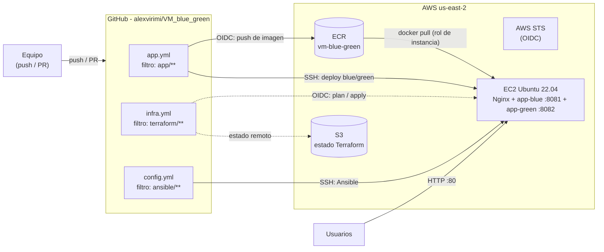
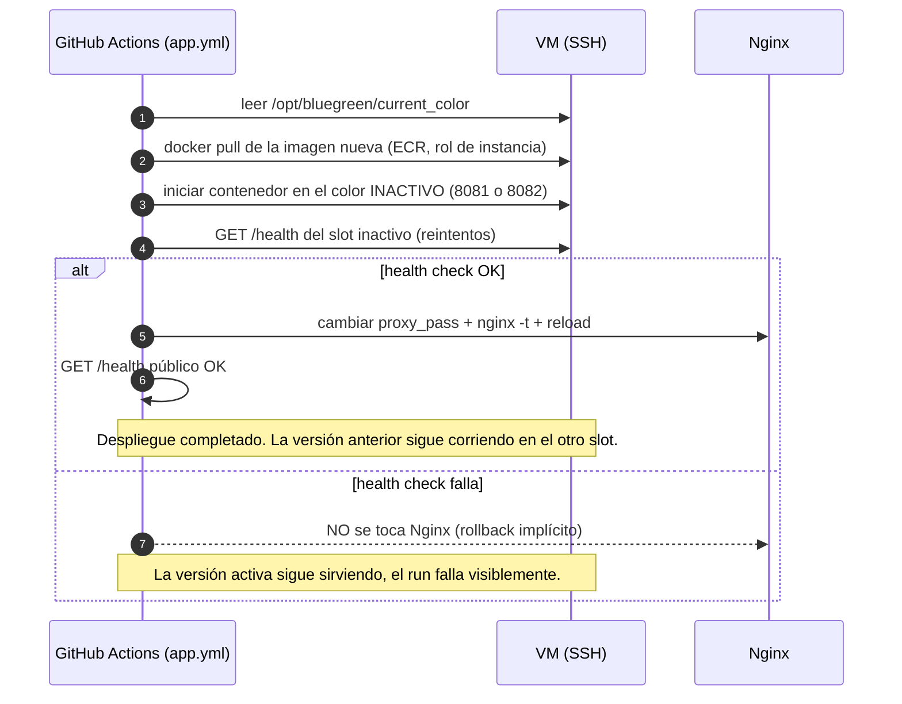

# VM_blue_green

Despliegue **blue/green** de una aplicación contenerizada en AWS, con infraestructura como código, CI/CD automatizado y controles de seguridad.

## Contexto

Una empresa quiere disminuir el tiempo de indisponibilidad al actualizar una aplicación contenerizada.

- **Plataforma:** AWS.
- **Herramientas:** Terraform, Ansible, Nginx, Docker, GitHub Actions, Checkov y Trivy.

## Actividades mínimas

- Crear con Terraform una máquina virtual en AWS.
- Configurarla mediante Ansible.
- Ejecutar dos versiones de la aplicación, azul y verde.
- Utilizar Nginx como proxy inverso.
- Construir y analizar la nueva imagen desde GitHub Actions.
- Desplegar una nueva versión en el ambiente inactivo y verificar el endpoint de salud.
- Cambiar a Nginx hacia la versión nueva solamente si la verificación es exitosa.
- Mantener una forma sencilla de regresar a la versión anterior.

## Arquitectura



**Componentes:**

- **`terraform/`** — IaC del equipo de infraestructura: VPC con subred pública, instancia EC2 Ubuntu 22.04 con IP pública, security groups, repositorio ECR privado (tags inmutables + scan-on-push), roles IAM (OIDC de GitHub para push a ECR, perfil de instancia para pull), backend S3 con lockfile nativo y hardening de cuenta.
- **`app/`** — Aplicación contenerizada del equipo de app (`Dockerfile`, escucha en el puerto **8080** y expone **`/health`**).
- **`ansible/`** — Configuración de la VM del equipo de config (docker, awscli, nginx y `bluegreen.conf`).
- **`.github/workflows/`** — Los tres pipelines de CI/CD (este documento).

```
VM_blue_green/
├── app/                     # Aplicación contenerizada (equipo app)
├── ansible/                 # Playbooks de configuración (equipo config)
├── terraform/               # Infraestructura como código (equipo infra)
├── .github/workflows/
│   ├── app.yml              # CI/CD de la aplicación: build, Trivy, ECR, blue/green, rollback
│   ├── infra.yml            # CI/CD de infraestructura: fmt/validate, Checkov, plan, apply
│   └── config.yml           # CI/CD de configuración: lint y aplicación del playbook
└── docs/                    # Evidencias de la entrega (fase 2)
```

## Workflows con filtros de paths

Cada workflow solo se dispara cuando cambian los archivos de su ámbito (**requisito del taller: distinguir aplicación, infraestructura y configuración**):

| Workflow | Filtro (`paths`) | En PR a `main` | En push a `main` | Ejecución manual |
|---|---|---|---|---|
| **app.yml** | `app/**` | Build de la imagen + **Trivy** (no publica nada) | + push a **ECR** (OIDC) + **despliegue blue/green** por SSH + health check + cambio de Nginx | `action=deploy` o `action=rollback` |
| **infra.yml** | `terraform/**` | `terraform fmt -check`, `validate`, **Checkov** (sin credenciales AWS) | + `terraform plan` + `terraform apply` automático (OIDC) | con `skip_apply=true` (solo plan) |
| **config.yml** | `ansible/**` | `yamllint` + `ansible-lint` | + aplicar el playbook contra la VM por SSH | — |

Notas de diseño:

- **En PR nunca se publica ni se despliega**; solo validaciones. El despliegue ocurre únicamente en push a `main`, que es la única rama en la que confía la política OIDC del rol IAM (`repo:alexvirimi/VM_blue_green:ref:refs/heads/main`).
- `infra.yml` aplica automáticamente en `main` (requisito del taller: *"un cambio en la infraestructura deberá ejecutar validaciones y aplicar los cambios"*). Un `terraform plan`/`apply` no puede pisar otro: hay un grupo de concurrencia por workflow y, además, el lockfile nativo de S3.
- Los despliegues de aplicación tampoco se pisan entre sí (`concurrency: bluegreen-deploy`, sin cancelación).
- Cada workflow imprime un **resumen en la pestaña Summary** del run (imagen publicada, color activo, resultados de seguridad, outputs de Terraform) para facilitar la recolecta de evidencias.

## Estrategia blue/green



**Convenciones en la VM** (acordadas entre equipos; `app.yml` las usa):

| Elemento | Convención |
|---|---|
| Contenedor azul | `app-blue`, puerto **8081** |
| Contenedor verde | `app-green`, puerto **8082** |
| Puerto interno de la app | **8080** (todos los contenedores) |
| Endpoint de salud | **`/health`** (HTTP 200) |
| Color activo | Archivo `/opt/bluegreen/current_color` (`blue` o `green`) |
| Nginx | `/etc/nginx/conf.d/bluegreen.conf` con `proxy_pass http://127.0.0.1:808x;` |
| Software base | docker, awscli y nginx instalados por el playbook de Ansible |

**Rollback** (forma sencilla de regresar a la versión anterior): el contenedor de la versión anterior **sigue corriendo** en el otro slot, así que revertir es solo repuntar Nginx. Desde la pestaña *Actions* → *App CI/CD (Blue-Green)* → *Run workflow* → `action=rollback` (`target_color=auto` elige el color inactivo). El workflow verifica que el color objetivo esté saludable antes de repuntar Nginx. Si un despliegue falla el health check, no hay que hacer nada: Nginx nunca llega a cambiar (rollback implícito).

## Controles de seguridad

| Control | Workflow | Qué hace | Resultado |
|---|---|---|---|
| `terraform fmt -check` | infra | Formato estándar del código IaC | Falla el pipeline si hay desviaciones |
| `terraform validate` | infra | Sintaxis y consistencia | Falla en errores |
| **Checkov** | infra | Análisis estático de la infraestructura (IaC) | Falla con hallazgos; skips justificados abajo |
| **Trivy** (imagen) | app | Vulnerabilidades `CRITICAL,HIGH` de la imagen Docker | Bloquea build/push/deploy |
| **Trivy** (repo) | app | Secretos expuestos en el repositorio | Bloquea el pipeline |
| `yamllint` / `ansible-lint` | config | Estilo y buenas prácticas de la configuración | Falla con hallazgos |
| ECR `scan_on_push` | (definido en Terraform) | Re-escaneo de vulnerabilidades al subir la imagen | Defensa en profundidad |

Además, endurecimiento propio de los workflows (ver skill *github-actions-hardening*):

- `permissions: {}` global: el `GITHUB_TOKEN` **nace sin permisos** y cada job declara solo los que usa (`contents: read`; `id-token: write` únicamente donde se asume un rol OIDC).
- Todas las acciones están **pinadas al SHA de commit** (los tags son mutables); la versión legible va como comentario.
- No se usa `pull_request_target` ni triggers privilegiados; en PRs de forks no hay secretos por diseño.
- Sin interpolación `${{ }}` directa en pasos `run:` (se usan variables de entorno intermedias) para evitar inyección de scripts.

## Manejo de credenciales

**Ninguna credencial vive en el repositorio** (requisito del taller):

1. **GitHub → AWS (OIDC, preferido):** los workflows asumen roles IAM con tokens OIDC de GitHub (`aws-actions/configure-aws-credentials`), sin claves de acceso almacenadas. La confianza está limitada a este repositorio y a la rama `main` (definida en `terraform/roles.tf` por el equipo de infra).
2. **GitHub → VM (SSH):** la clave privada del key pair de EC2 se guarda como **GitHub Secret** (`SSH_PRIVATE_KEY`), la forma permitida por el taller cuando no aplica OIDC (Ansible requiere SSH).
3. **VM → ECR:** la VM descarga imágenes usando su **perfil de instancia IAM**, sin credenciales en disco.

## Variables y secretos requeridos en GitHub

Configurar en **Settings → Secrets and variables → Actions**:

**Variables** (no son secretas):

| Variable | Ejemplo | Uso |
|---|---|---|
| `AWS_REGION` | `us-east-2` | Región de todos los pasos AWS |
| `AWS_ACCOUNT_ID` | `123456789012` | Construcción del registry ECR |
| `ECR_REPOSITORY` | `vm-blue-green` | Repositorio de imágenes |
| `ECR_ROLE_ARN` | `arn:aws:iam::…:role/vm-blue-green-github-ecr-publisher` | Rol OIDC para push a ECR (ya existe en Terraform) |
| `TF_ROLE_ARN` | `arn:aws:iam::…:role/vm-blue-green-github-terraform` | Rol OIDC para plan/apply (**pendiente**, ver abajo) |
| `TF_STATE_BUCKET` | *(por definir)* | Bucket S3 del estado de Terraform |
| `TF_STATE_KEY` | `vm-blue-green/terraform.tfstate` | Clave del estado (opcional, hay default) |
| `EC2_KEY_NAME` | `vm-blue-green-key` | `-var key_name` |
| `SSH_ALLOWED_CIDR` | `0.0.0.0/0` | `-var ssh_allowed_cidr` (ver decisión 2) |
| `OIDC_PROVIDER_ARN` | `arn:aws:iam::…:oidc-provider/token.actions.githubusercontent.com` | Crea el rol publicador ECR (opcional) |
| `VM_PUBLIC_IP` | *(la actualiza infra.yml tras el apply)* | Host SSH para deploy y Ansible |
| `VM_SSH_USER` | `ubuntu` | Usuario SSH (opcional, default `ubuntu`) |

**Secrets:**

| Secret | Contenido |
|---|---|
| `SSH_PRIVATE_KEY` | Clave privada (formato OpenSSH) del key pair de EC2 |

> **Actualizar `VM_PUBLIC_IP` a mano (fallback):** tras un `terraform apply` que reemplace la instancia, si el paso automático no tiene permisos: `gh variable set VM_PUBLIC_IP --body "<IP>" --repo alexvirimi/VM_blue_green`.

## Cómo probar

1. **Infraestructura:** configurar las variables/secrets de arriba → abrir un PR que toque `terraform/**` (validaciones sin AWS) → merge a `main` → `infra.yml` ejecuta plan y apply → anotar la IP pública del output.
2. **Configuración:** crear los playbooks en `ansible/` (o disparar `config.yml` manualmente) → el playbook instala docker, awscli y nginx y crea `bluegreen.conf`.
3. **Aplicación:** crear la app en `app/` con `Dockerfile` (puerto 8080, `/health`) → PR para ver build + Trivy → merge a `main` → despliegue automático al color inactivo → verificación de salud → cambio de Nginx.
4. **Acceso:** `http://<VM_PUBLIC_IP>/` y `http://<VM_PUBLIC_IP>/health`.
5. **Rollback:** *Actions → App CI/CD (Blue-Green) → Run workflow → action=rollback*.
6. **Evidencias para la entrega** (capturas de los runs con su Summary): despliegue de app exitoso, hallazgos de Checkov y Trivy, apply de infraestructura, y rollback.

## Registro de decisiones

1. **Canal de despliegue por SSH + GitHub Secret** (en lugar de SSM/OIDC total): Ansible funciona de forma nativa por SSH y es el patrón estándar. Trade-off: exige abrir el puerto 22 al mundo (key-only). *Mejora futura: SSM Session Manager sin puerto 22.*
2. **SSH 22 abierto a `0.0.0.0/0`** (hoy la validación de `ssh_allowed_cidr` exige un `/32`): los runners de GitHub Actions tienen IPs dinámicas e impredecibles; restringir por CIDR no es viable. Mitigación: solo autenticación por clave, sin contraseña. *Checkov CKV_AWS_24 queda en el skip list con esta justificación.*
3. **`terraform apply` automático en `main`:** interpretación literal del requisito ("ejecutar validaciones y aplicar los cambios"). Los PRs solo validan. Protección extra: concurrencia + lockfile S3. *Mejora futura: GitHub Environment con aprobación manual.*
4. **Rutas de filtros `terraform/` + `app/` + `ansible/`:** se respeta la carpeta `terraform/` que ya existía del equipo de infra; `app/` y `ansible/` son la convención para los demás entregables.
5. **Tags de imagen únicos por ejecución** (`sha-<git-sha>-r<número>-a<intento>`): el repositorio ECR tiene **tags inmutables**; re-ejecutar un run no colisiona con el tag anterior. No se usa `latest`.
6. **Trivy bloquea con `CRITICAL,HIGH`** y `--ignore-unfixed`: ruido razonable para un proyecto docente. *Mejora futura: bajar a `CRITICAL` si la imagen base lo exige.*
7. **Checkov falla ante cualquier hallazgo**, con `--skip-check` **solo para desviaciones deliberadas del diseño**, cada una justificada aquí: `CKV_AWS_88` (IP pública en la EC2: requisito del taller para acceso HTTP directo), `CKV_AWS_260` (puerto 80 público: la app es de acceso público), `CKV_AWS_24` (SSH público: decisión 2), `CKV_AWS_158` (log group sin KMS: cifrado en reposo gestionado por AWS, sin CMK en el laboratorio), `CKV_AWS_338` (retención de logs de 7 días por control de costos en lugar de 1 año), `CKV_AWS_145` (S3 con SSE-S3 gestionado por AWS en lugar de KMS/CMK), `CKV_AWS_21` (bucket temporal de transferencia SSM sin versionado: se recrea y vive 1 día), `CKV_AWS_144` (sin replicación cross-region: evitaría una segunda región y su costo), `CKV_AWS_18` (sin access logging: bucket temporal sin valor de auditoría), `CKV2_AWS_62` (sin notificaciones de eventos: bucket temporal efímero), `CKV_AWS_136` (ECR con `AES256`, cifrado en reposo gestionado por AWS en lugar de KMS/CMK). *Regla del equipo: cada skip nuevo debe registrarse en esta lista.*
8. **Acciones pinadas a SHA de commit y permisos mínimos por job:** protección de cadena de suministro y del token (ver sección de seguridad).
9. **Terraform 1.11.4 fijado** en CI: reproducibilidad y soporte del lockfile nativo de S3 (`use_lockfile`).
10. **Estado blue/green en la propia VM** (`/opt/bluegreen/current_color`): fuente de verdad simple y observable con SSH, sin dependencias externas.
11. **La imagen viaja entre jobs como artefacto efímero** (retención 3 días): el job de build no necesita permisos AWS y el pipeline queda con mínimo privilegio por job.

## Coordinación y pendientes

- [x] **Equipo infra:** crear el rol OIDC de Terraform para CI (`TF_ROLE_ARN`) con permisos de estado S3 + recursos del proyecto; el actual solo tiene permisos de push a ECR.
- [ ] **Equipo infra:** relajar la validación `/32` de `ssh_allowed_cidr` para permitir `0.0.0.0/0` (decisión 2).
- [x] **Equipo infra:** definir el bucket real del backend (`backend.hcl` tiene un placeholder).
- [ ] **Equipo infra:** sincronizar `terraform.tfvars.example` con `variables.tf` (menciona `alert_email`, `budget_limit_usd`, etc., que aún no existen) y eliminar los dos archivos basura en `terraform/` (comandos pegados como archivos: `budgets describe-budgets…` y `cloudtrail validate-logs ✓`).
- [x] **Equipo app:** `Dockerfile` en `app/`, app escuchando en 8080 con `/health`.
- [ ] **Equipo config:** playbook de entrada `ansible/playbook.yml` (o `site.yml`) que instale docker, awscli, nginx y cree `/etc/nginx/conf.d/bluegreen.conf` con `proxy_pass http://127.0.0.1:8081;` (formato que `app.yml` espera para el switch).
- [ ] **Verificar** si el `GITHUB_TOKEN` puede hacer `gh variable set VM_PUBLIC_IP` tras el apply; si no, usar el fallback manual documentado.

## Limitaciones y posibles mejoras

- El switch de Nginx se hace con `sed` sobre `bluegreen.conf`: funciona pero es provisional; cuando el rol de Ansible de nginx exista, el deploy podría delegar en él.
- El health check del slot inactivo se hace por SSH (`curl` local en la VM); se podría exponer el slot inactivo solo al runner.
- Sin SARIF: los resultados de Checkov/Trivy viven en los logs y el Summary; *mejora: subirlos a la pestaña Security*.
- Sin aprobaciones manuales para producción; *mejora: GitHub Environments con reviewers*.
- `VM_PUBLIC_IP` como variable de repositorio: si la instancia se recrea, hay una ventana donde el deploy apunta a la IP vieja.
- Los contenedores no tienen límites de recursos (cpu/memoria) definidos por defecto en `docker run`; el control de costos principal es el presupuesto/budgets de AWS y el tamaño `t3.micro`.
